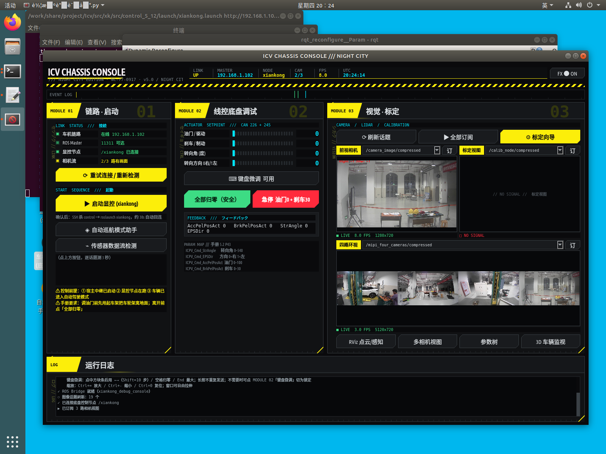
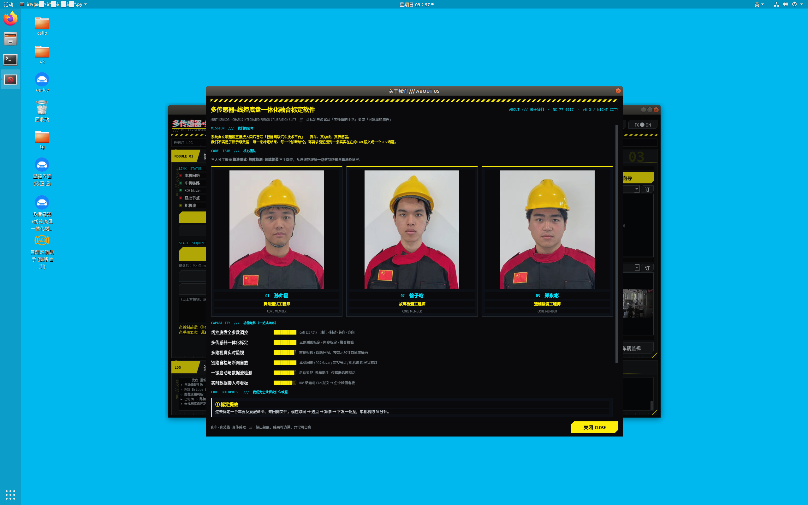

# 车机调试台 · 多传感器 + 线控底盘一体化融合标定软件

> MULTI-SENSOR + CHASSIS INTEGRATED FUSION CALIBRATION SUITE — `v7.4 / NIGHT CITY`

面向**智能网联汽车技术平台**的图形化调试台：把线控底盘调控、多路视觉与标定、ROS 链路自检收进同一个界面。
单文件 Python 程序（约 2000 行），运行在**车机侧的 Ubuntu 图形会话**中。



---

## 它解决什么问题

调车机时最烦的三件事：**链路通不通要靠猜、底盘状态要看一堆终端、相机画面和标定数据散在各处**。
这个调试台把三者合并到一屏，并在启动时做链路自检，把"连不上"变成一句能读懂的原因。

## 界面结构（按操作顺序排布）

| 模块 | 内容 |
|---|---|
| **MODULE 01 · 链路/启动** | ROS Master 连通性、宿主中继状态、话题存活；一键重试连接 |
| **MODULE 02 · 线控底盘** | 转向 / 驱动 / 制动协同调控与状态回读 |
| **MODULE 03 · 视觉/标定** | 相机实时画面（多路可切）、点云与感知、融合标定向导 |

另有内置「关于我们 / 软件介绍」界面（标题栏 `◈ 关于我们` 芯片按钮，或 `F1` / `Ctrl+I`）。



## 视觉语言

参考 Cyberpunk 2077：招牌黄 + 数据青、削角芯片、方块段电平条、斜纹警示条、Relic 式红青分离故障（**全部局部化，特效可关**）。
状态色严格统一：**绿 = 正常 / 红 = 异常**，不做装饰性用色。

## 运行环境

| 项 | 要求 |
|---|---|
| 系统 | Ubuntu（图形会话，`DISPLAY=:0`） |
| Python | **Python 2.7** |
| ROS | ROS 1（Melodic 实测；需 `rospy`、`rosgraph`、`sensor_msgs`、`dynamic_reconfigure`） |
| 图形库 | PyQt5 |
| 其他 | OpenCV（`cv2`）、NumPy |
| 网络 | 车机为 ROS Master（默认 `192.168.1.102:11311`）；本机需以 `ROS_IP` / `ROS_HOSTNAME` 对外宣称自身 IP |

本机（调试机）实测口径：`ROS_MASTER_URI=http://192.168.1.102:11311`、`ROS_IP=192.168.1.109`、`ROS_HOSTNAME=192.168.1.109`。

## 启动方式

```bash
# 方式一：带自检的启动器（推荐）
#   先检查车机可达性 + 宿主中继，再拉起界面；有问题用 zenity 弹窗说明
bash 启动车机调试台.sh

# 方式二：直接跑（图形会话内）
export DISPLAY=:0
source /opt/ros/melodic/setup.bash
export ROS_MASTER_URI=http://192.168.1.102:11311
export ROS_IP=192.168.1.109
export ROS_HOSTNAME=192.168.1.109
python2 车机调试台.py
```

> 启动器会做两项前置自检：
> ① **车机可达**（`ping 192.168.1.102`）—— 网线要插在车机**机身内置网口**；
> ② **宿主中继在监听**（`192.168.1.109:20000`）—— 反向通路，控制指令必需。
> 任一失败仍会打开界面，可点「重试连接」。

## 两个易错点（实测踩过）

1. **反向通路必须有宿主中继**。车机→本机的控制回包走不通时，界面能开但指令无效 —— 先在 Windows 宿主上确认 ROS 中继已运行。
2. **`ROS_HOSTNAME` 不要留成别的网段的旧值**。换网络后若还写着旧 IP，车机会回连失败；改成本机当前地址。

## 文件

| 文件 | 说明 |
|---|---|
| `车机调试台.py` | 主程序（单文件，约 2000 行） |
| `启动车机调试台.sh` | 带自检的启动器 |
| `一键启动控制台.sh` | 由 Windows 侧调用的图形会话拉起脚本（自动定位 `XAUTHORITY`） |
| `preview-夜之城版.png` / `preview-关于我们.png` | 实测界面截图 |

## 说明

- 程序内写有默认的 ROS Master / 本机 IP，**换环境请按上表修改**再运行。
- 涉及**线控底盘**的调试请在确保车辆处于安全状态（举升或空场）下进行。
